
# GitHub

In order to host our websites on the internet and edit our code, we will be using GitHub. GitHub Pages is a free web-hosting service provided by GitHub that publishes a website directly from a GitHub repository. Github Codespaces is a way to edit our projects online using a virtual machine.

## Downloading p5 folder

To begin creating our own website, we’ll first need to download the p5.js sketch we have been working on.

To download your p5 project:

1. Navigate to file > download 
   
   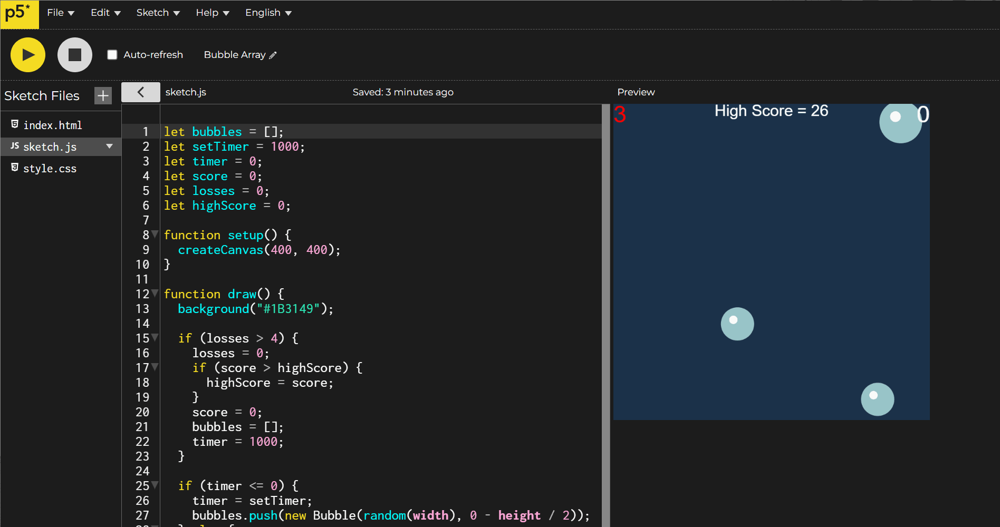
2. Unzip the downloaded project folder (Right-click > extract all on Windows, Double-click on MacOs) 
   
   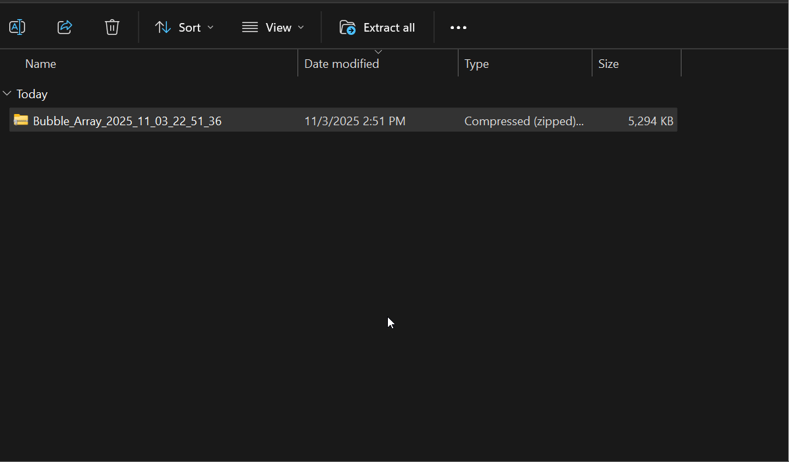

You can optionally rename your project folder to the name of your project:

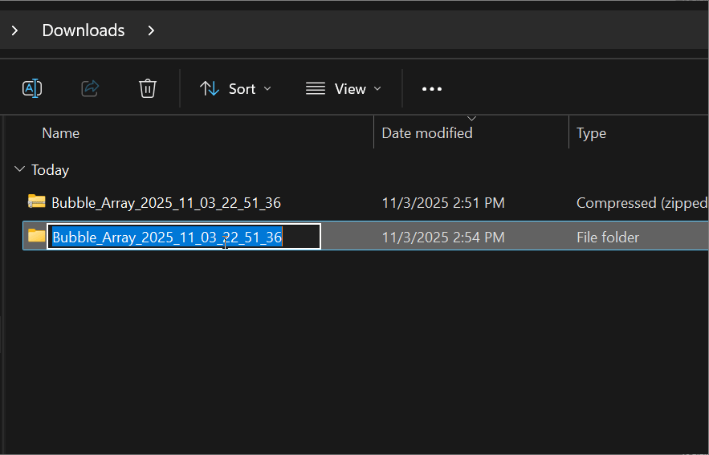

## Setting up a GitHub Repository

### 1. Make a GitHub account

Navigate to [GitHub.com](https://github.com/) to make a free GitHub account if you do not have one already. You also sign up for an [education](https://github.com/education) account that has extra benefits. 

### 2. Make  New Repository

After you make a GitHub account, create a new Repository that will host your website code. 

After clicking on new repository:

1. Name your repository using Repository name input box - this name will be included in the web address of your website
2. Set your visibility to Public
3. Choose what license you want for your website. Since your repository will be public, you can decide how you want others to be able to access the code and content on your repository and site.

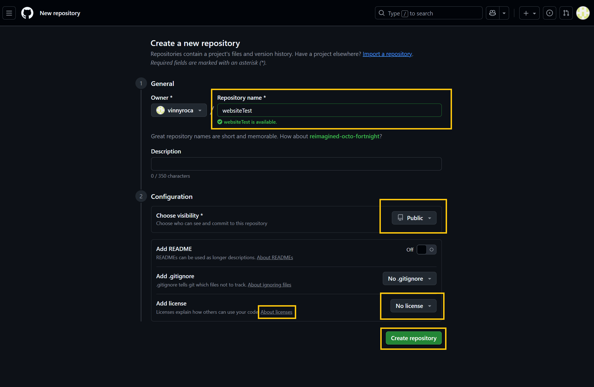

### 3. Upload Your Files to Your Repository

There are many ways to connect files to your repository. Most commonly, programmers will use [GIT](https://git-scm.com/) to connect their local files to a repository. For ease of use, we will be uploading files using the upload feature within GitHub. 

After creating your repository:

1. Click on “uploading an existing file” on your repository page
   
   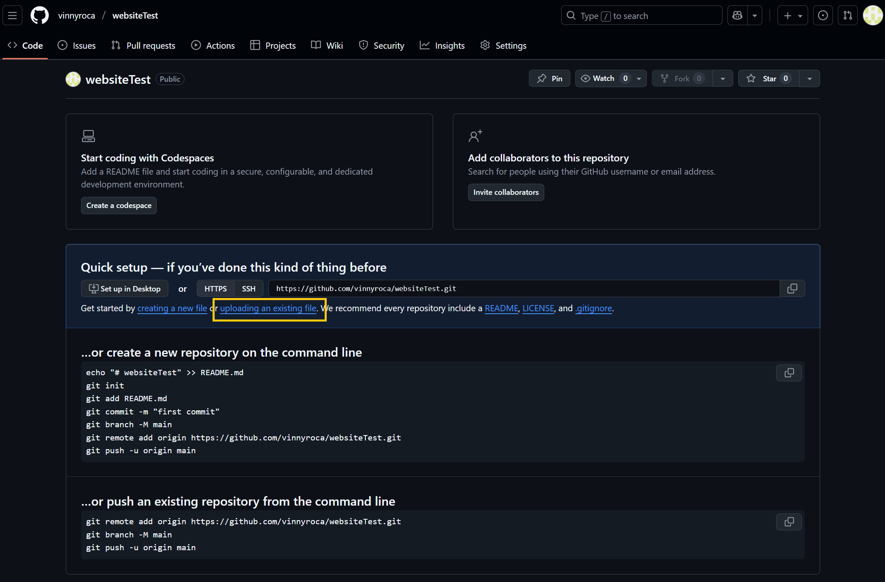
2. Drag or upload all of the files from your website folder into the repository 
   
   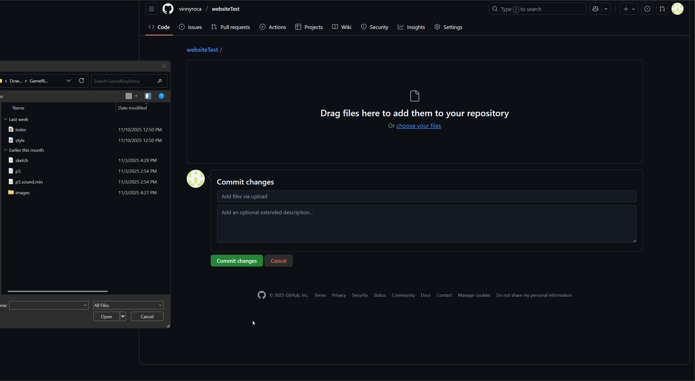
3. Commit the changes - you must add a description of the commit 
   
   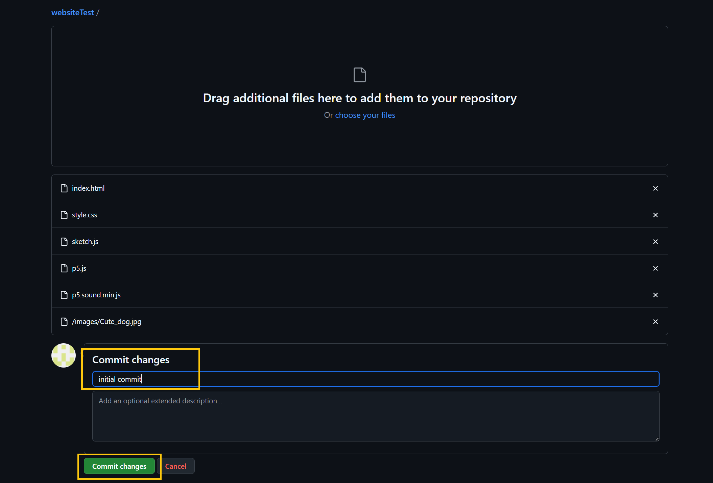

#### Updating Files

GitHub will automatically update files of the same name if upload them to your repository. For example, if you make changes to any of the code files, you only need to reupload them to your repository and commit the changes. GitHub will automatically update these files to match the newly uploaded files. It is best practice to only reupload files that you have changed.

To reupload a file:

1. In your repository home page, navigate to Add File > Upload files
2. Commit any changes to reuploaded files

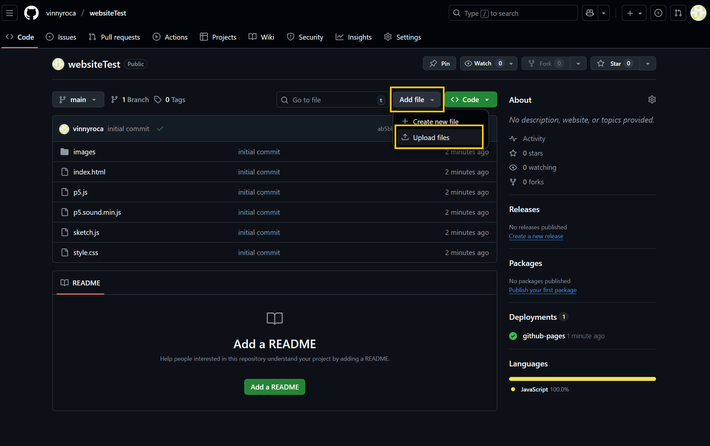

### 4. Setting up GitHub pages and Viewing Your Site

Once your files have been uploaded to your repository, you can publish your site as a GitHub pages page. This site will be a live site that can be accessed at `UserName.github.io/RepositoryName/`

To set up your Pages site:

1. Navigate to Settings in the top menu bar in your repository
2. In the left pane, navigate to Pages
3. Within GitHub Pages settings, set Branch to main and press save

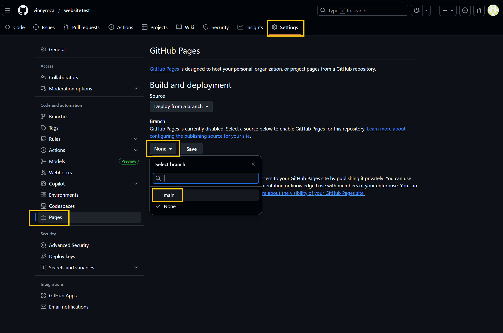

Within a few minutes, your website will be live. You can find the address for the site by navigating back to the Pages settings of your site.

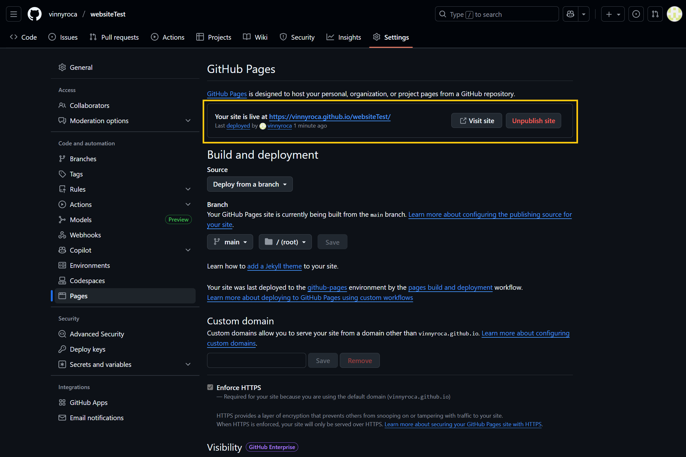

### Optional: Custom Domain

If you wish to have a custom domain for your site, you can follow these [instructions](https://docs.github.com/en/pages/configuring-a-custom-domain-for-your-github-pages-site) provided by GitHub 

## Open Project in Codespaces

Now that we have our project uploaded to a repository. We can edit the project using Github Codespaces. 

To navigate to codespaces:

1. Navigate to github.com/codespaces (make sure you are logged in already)
2. Click the New codespace button
3. Select your newly created repository
4. Select Create codespace
5. Select Trust Folder & Continue

Your UI should look similar to the below image. We now have a virtual environment to edit our code.

Components of a p5 Project

When looking at our p5 project, we notice that it made up of at least 4 if not 5 files including the p5 sound library:

- `index.html` - the base structure of our website
- `style.css` - the styling of our website
- `sketch.js` - our p5 sketch as a JavaScript file
- `p5.js` - the p5.js library
- `p5.sound.min.js` - the p5 sound library
## Visualizing Site with Live Server

Live Server is an extension to VSCode that will allow you to view your webpage in your browser.

You can install Live Server by navigating to **Extensions** > **Searching** for Live Server > Press **Install**. 

You can launch your website by using the Go Live button in the bottom left corner of your window.

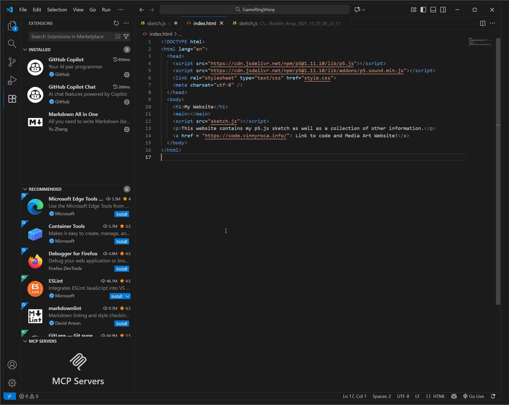

# Committing Changes

When working in Codespaces our changes will save, however, we must manually commit those changes to our repository.

When you are ready to commit changes, you can navigate to the Source Control Button, Enter a Commit Message, and then press Commit. You will then need to press Sync Changes to push your changes to your repository. You can stage specific changes by pressing the plus button next to the files that you want to commit and push to your repository.

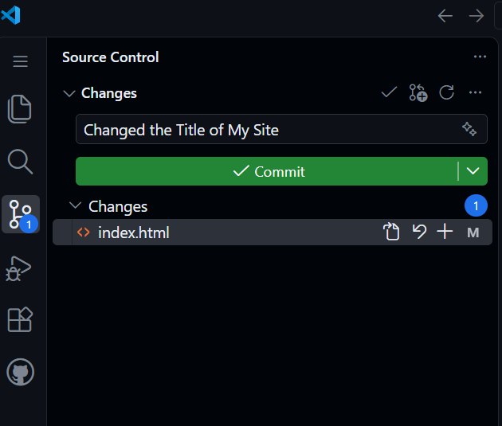

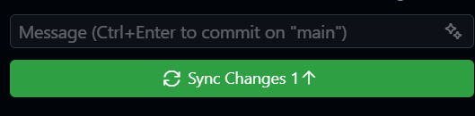